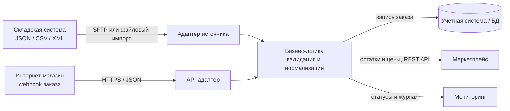

# Модульная архитектура

## Границы модулей

- **Domain** — объекты товара, заказа и результата обработки.
- **Ports** — интерфейсы источников, приемников и хранилища.
- **Adapters** — работа с JSON-файлом, внешним API и хранилищем.
- **Application** — сценарии синхронизации остатков и приема заказов.

Сочетание уровней оправдано разными требованиями: файлы удобны для пакетного обмена, REST API — для оперативной синхронизации, а бизнес-логика централизует проверку и преобразование данных.
